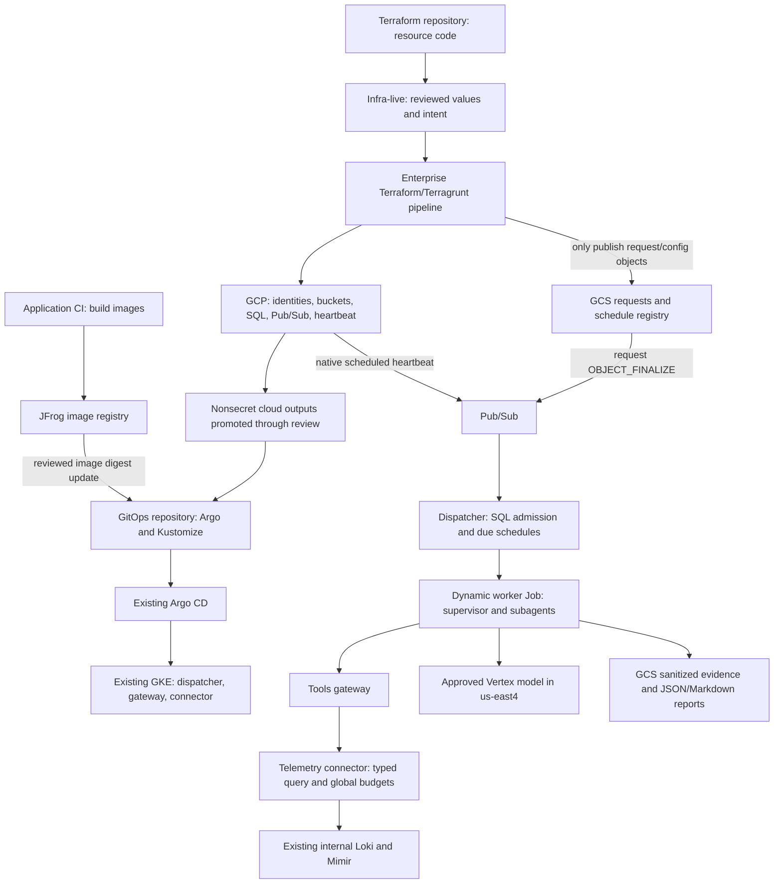

# Example 2 of 3: deploy configuration, then register an investigation

The question is: **why did reconciliation latency increase in the Azure-CD Argo controller infrastructure?** We investigate only that CI/CD infrastructure's centrally collected logs and metrics. We never query application destination clusters.

This folder connects real Terraform resource definitions in [terraform-modules](https://github.com/edgo19/harness-terraform-modules/tree/examples/argo-infrastructure-investigation/examples/argo-infrastructure-investigation) to Kubernetes definitions in [gitops](https://github.com/edgo19/harness-gitops/tree/examples/argo-infrastructure-investigation/examples/argo-infrastructure-investigation). Use this walkthrough first if the general architecture documents are too abstract.

**This is a complete configuration example, not a running harness.** `us-east4` is selected; other infrastructure values are mocks. The example uses local sibling module sources so you can inspect everything together. Its deployment guard always blocks cloud execution. Runtime images, actual SQL schemas and backend integration are not implemented. The output files under `expected/` are explicitly synthetic and have not been uploaded.

## Start with these concrete files

| File | What you supply / what it means | What reads it | Result |
|---|---|---|---|
| [scenario.json](scenario.json) | Project `mock-harness-dev`, GKE project, `us-east4`, bucket names, namespace/identity relationships and existing backend references | Terragrunt platform inputs and cross-repository checks | One consistent naming/configuration example; identical copy in all three repositories |
| [deployment.json](deployment.json) | `deployment_enabled: false` | Shared example root/guard | No plan/apply is permitted through the shipped example |
| [live/platform/terragrunt.hcl](live/platform/terragrunt.hcl) | The scenario object | Example `platform/` module in the sibling Terraform repository | Would provision dev identities, storage, messaging, SQL and paused heartbeat; outputs cloud identifiers |
| [request.json](request.json) | A unique ID, capability, goal, source, 30-minute window and requested budgets | `live/request` → example `registration/` | Would create `gs://mock-harness-dev-requests/requests/example-argo-latency-001.json` with a content hash |
| [live/request/terragrunt.hcl](live/request/terragrunt.hcl) | Request bucket and structured request; no credentials/endpoints | Request-publisher pipeline and registration module | Separate request state. Does not read platform Terraform state or execute a task |
| [registry.json](registry.json) | Schedule `argo-controller-health`, every 30 minutes UTC, initially disabled | `live/schedules` → example schedule module | Immutable registry object and `gs://mock-harness-dev-configuration/schedules/current.json` pointer |
| [live/schedules/terragrunt.hcl](live/schedules/terragrunt.hcl) | Configuration bucket, retained revision map and current key | Schedule-publisher pipeline | Separate schedule state; runtime decides due occurrences |
| [expected/metrics.json](expected/metrics.json), [logs.jsonl](expected/logs.jsonl) | Synthetic sanitized evidence for reading the example | Human reader/checks only | Illustrates evidence shape; these are not fetched backend observations |
| [expected/report.json](expected/report.json), [report.md](expected/report.md) | An illustrative finding, limitations, recommendations and evidence references | Human reader/checks only | Shows future GCS JSON/Markdown reports and fixture hashes, not an executed agent result |

The three independent state prefixes are `harness/examples/argo-infrastructure-investigation/dev/live/platform`, `/live/request` and `/live/schedules`. The state bucket already exists outside this example. State privilege and publisher privilege must both be restricted; a request publisher does not receive infrastructure or operator state access.

## Relationship diagram: the entire system



## Follow one ad-hoc request from start to finish

1. A reviewed application release exists: runtime, gateway and telemetry images have been built to JFrog. Terraform has provisioned hosting resources. SQL bootstrap/migrations, PKI, image authentication and the shared query-budget database have been verified. GitOps deploys the control plane. **These are prerequisites, not actions completed by this example.**
2. An author supplies [request.json](request.json). It asks about the controller infrastructure source and cannot choose an endpoint, token, tenant or credential. A real request would reference a released capability; `@1.0.0-design` here is a placeholder.
3. The request-registration pipeline runs only that new request's Terraform unit with request-bucket publisher/state rights. Terraform writes immutable JSON and exits. A production registration would use its own unique request directory/ID; this example has one fixed unit for readability.
4. GCS sends an `OBJECT_FINALIZE` notification to the requests topic. Pub/Sub delivers at least once to `harness-dev-requests`. The dispatcher authenticates with its own GSA, reads the exact generation, validates schema/hash and performs SQL ID/hash admission and outbox handling. It acknowledges after durable admission. Duplicates do not create a second canonical run.
5. Dispatcher creates a `batch/v1 Job` in `harness-workers-dev` using the fixed reviewed worker template. The Job runs the generic harness worker, not Terraform. That worker hosts the Deep Agents/LangGraph supervisor, bounded metrics/logs specialists and evidence reviewer. All share the worker workload identity and total run budgets.
6. The metrics specialist requests the `argo-reconcile-p95` typed template for the trusted source and bounded time window. The tool wrapper obtains a Google ID token through native GKE WIF, outside the model prompt, then calls the HTTPS gateway. Gateway verifies issuer/signature/expiry/audience and the worker GSA numeric subject, applies the fixed read-only class policy, and uses its own audience-bound token to call the connector.
7. The connector validates the gateway token. It reserves a global Mimir slot through the **same production-hosted `query_budget` DB used by all environments**, compiles the reviewed template with fixed hosting-cluster/namespace matchers, queries internal Mimir and returns bounded sanitized evidence. The logs specialist similarly uses `controller-errors` against internal Loki. No arbitrary PromQL/LogQL, shell or HTTP tool is exposed. Backend scans need real validated limits; `topk`, line limits and small response limits are not scan guarantees.
8. Worker checkpoints stay in the dev `harness` SQL database. Large sanitized evidence goes to GCS; model context contains relevant excerpts/references, not credentials or unbounded logs. Per-run memory survives for diagnosis, but automatic checkpoint resume and cross-run learning are disabled initially.
9. The reviewer separates observations from hypotheses, checks evidence coverage and writes JSON/Markdown report candidates. Runtime terminal publication/CAS makes a canonical report. The example [report](expected/report.md) shows the format; it does not claim that these steps actually ran.

## Which software runs where?

| Software / activity | Resource | Identity / access | Output |
|---|---|---|---|
| Enterprise Terraform/Terragrunt process | Existing enterprise pipeline runner | Existing WIF-authenticated provisioner or restricted publisher, depending on path | Cloud resources or registered intent; no investigation |
| Argo CD | Existing deployment controller | Existing repository and cluster permissions | Kustomize desired state on hosting GKE |
| Dispatcher | GKE Deployment, control namespace | Dispatcher KSA→GSA; named Pub/Sub subscriptions, input objects, dev SQL, worker namespace Job RBAC | Durable run admission and worker Job |
| Supervisor, metrics/logs specialists, reviewer | One dynamic GKE worker Job for this request | Worker KSA→GSA; Vertex, per-run SQL, evidence/report buckets and gateway class scope | Analysis and sanitized artifacts |
| Tools gateway | GKE Deployment, control namespace | Gateway KSA→GSA for connector-bound ID token; validates worker numeric subject | Authorized typed tool request |
| Telemetry connector | GKE Deployment, tools namespace | Telemetry KSA→GSA for shared SQL budget; gateway token validation; internal-only Loki/Mimir | Scoped bounded sanitized evidence |
| Checkpoints / run ledger | Private dev Cloud SQL `harness` DB | Different SQL roles per function; IAM login alone is insufficient | Run state and per-run context |
| Global query coordinator | Existing/provisioned production HA SQL `query_budget` DB | Dev/prod telemetry GSAs get reservation procedure rights only | One Loki and one Mimir in-flight query globally |
| Loki/Mimir and Alloy | Existing observability GKE workloads | Existing internal paths; existing collector | CI/CD infrastructure telemetry; target-cluster telemetry is excluded by source policy |

## How the same flow is scheduled

There are two different clocks. Cloud Scheduler emits **one minute heartbeat** to Pub/Sub. The registry describes **every 30 minutes UTC** for this task. No Scheduler job is created per agent task.

Once a reviewed registry enables the schedule and runtime readiness is confirmed, the dispatcher imports its current pointer by GCS generation. Each heartbeat causes SQL due-time evaluation and unique `(schedule_id, nominal_due_utc)` admission. `forbid` prevents overlap; `latest-eligible-only` plus ten-minute grace prevents a catch-up storm. The admitted occurrence then follows steps 5–9 above. Creator credentials and a human login are not involved.

Both switches are off in this example: registry schedule `enabled: false` and Scheduler heartbeat `paused: true`. Removing a request or a registry object is not cancellation. An operator would use the separately authorized control-registration path described in the main live repository.

## Run the offline checks

Clone all three repositories beside each other and check out branch `examples/argo-infrastructure-investigation` in each. Use Python 3.12/3.13, uv, Terraform 1.16.6, Terragrunt 1.1.6 and Kustomize 5.7.1 on PATH.

```text
workspace/
  harness-terraform-modules/
  harness-infra-live/
  harness-gitops/
```

From this repository root:

```bash
uv sync --frozen
make example-check
```

This verifies matching scenario/request/registry copies, normal task/schedule schemas, three independently rendered Terragrunt units and the GitOps manifests/identity boundaries. It does not contact GCP/Kubernetes or execute an investigation. Module provider installation/tests have their own `make example-check` in the Terraform repository.

The local-source example guard always blocks deployment, even if its flag is edited. A real deployment must first promote tested version-pinned modules into the normal live stack, replace/verify mocks, apply enterprise reviews and supply working runtime images. This avoids mistaking an understandable example for a deployable release.
